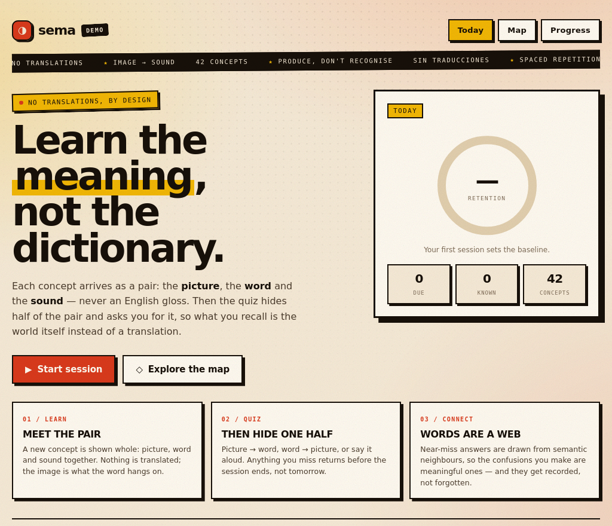

# hablo — meaning-first language learning

A working front-end demo of a language app that teaches the target first, then checks it.

A concept is introduced as a pair — picture, word, sound — with the meaning hidden behind a
**show translation** control on the card. The drill data itself carries no English gloss
inline; a separate `glosses.js` map supplies it. Then the quiz hides one half and asks you for the other: picture
→ word, word → picture, or say it aloud. What you miss comes back before the session ends.

42 Spanish concepts and 60 phrases, 43 semantic relations, spaced repetition, a lesson
builder that chooses what you study, spoken production, a twelve-lesson tutor path from first
contact to a B1 bridge —
and audio that ships with the app instead of depending on your operating system.



## Run it

One command, standard library only:

```sh
python3 serve.py
```

That serves the folder on the first free port from 8080, prints the URL, opens your browser,
and sends no-cache headers so edits show up on reload.

```sh
python3 serve.py --port 9000     # pin a port
python3 serve.py --no-open       # don't launch a browser
make serve                       # same thing, if you prefer make
```

Use the printed `http://localhost:…` URL rather than opening `index.html` from the
filesystem: browsers gate microphone access behind a secure context, and `file://` doesn't
qualify. Any other static server works too — there is no build step.

Deep links: `#practice` (start a session), `#phrases` (phrase lesson), `#quiz` (quiz
only, no teaching), `#read`, `#stats`.

Keyboard: **Enter** advances, **1–4** pick an answer, **Esc** leaves a session.

## Pick what you learn

The Today view has a builder: toggle the semantic fields you actually need (Food, City,
Body…), pick 5/8/12 cards, and start. The session draws only from that pool, reviews first,
then new concepts. **Review my mistakes** builds a quiz from everything you have got wrong,
worst first. Both choices persist in `localStorage`.

## The loop

1. **Learn.** A new concept is shown whole: picture, word, article, a sentence, and the
   sound. Both halves visible at once — that is where the association forms.
2. **Quiz.** One half is hidden. Four ways to answer: pick the word for a picture, pick the
   picture for a word, or say it (browser recognition, scored by edit distance).
3. **Miss and repeat.** A wrong answer is pushed to the back of the same quiz, so it is
   re-tested before you leave — and scheduled 10 minutes out, not tomorrow.

## What is implemented

| Feature | Where | Notes |
|---|---|---|
| Study phase | `renderStudy` | Picture + word + sentence + audio, one concept at a time |
| Quiz: word from picture | `renderPickWord` | Spanish options only; distractors are semantic neighbours |
| Quiz: picture from word | `renderPickPicture` | Word shown, four pictures |
| Quiz: production | `renderSay` | Browser recognition + edit-distance score, self-check fallback |
| In-session requeue | `answer` | A miss reappears before the session ends |
| Spaced repetition | `src/srs.js` | SM-2; a lapse reschedules to 10 minutes |
| Confusion tracking | `recordConfusion` | Surfaces as "most confused pairs" in Progress |
| Progress roadmap | `renderStats` | One ring per topic, filled by the share of its words met |
| Audio diagnostics | `audioStatus` | Reports voice availability instead of playing nothing |
| Lesson builder | `renderBuilder` | Field toggles, words/phrases switch, session size |
| Phrase deck | `src/phrases.js` | Whole utterances, scene-anchored; English gloss in `glosses.js` |
| Mistake review | `reviewMistakes` | Quiz built from your lapses, worst first |
| Progress | `renderStats` | Coverage per field, sessions, recalls, lapses |

Everything is stored in `localStorage` under `sema.v1`. No analytics, no network calls after
the page loads.

## Audio

The words are **pre-rendered WAV files committed to the repo** (42 files, 576 KB). The browser
plays an `<audio>` element, so playback does not depend on any voice installed in the
operating system — which is what made the earlier version silent on machines without one.

Speech synthesis is now only a fallback, used if the manifest is missing. The footer chip
reports which path is active (`bundled audio · 42 words`), and the earlier "no voice on this
device" message only appears when there is genuinely no audio at all.

102 clips: 42 words and 60 phrases, spoken by the same voice, at 16 kHz with the edges
faded and every clip peak-normalised so none is quieter than its neighbours. eSpeak is
formant synthesis and will never sound human — slower rate, a touch more pitch and the
resampling above is as far as it goes without a neural engine, which would mean a
dependency the project does not take.

To regenerate (needs `libespeak-ng` at build time, nothing at runtime):

```sh
python3 tools/make_audio.py
```

Replacing them with real recordings is a drop-in change: same file names, same manifest.

## Verify it

```sh
make check          # syntax gate + full suite
node --test tests/  # the tests on their own
```

31 tests, standard library only: scheduling arithmetic, the similarity matcher, queue
construction, distractor selection, dataset integrity (unique ids, unique images, no
dangling relations) and consistency between the markup and the script — the kind of breakage
a no-build front end otherwise surfaces only in the browser.

## Layout

```
index.html          shell, four views
serve.py            local preview server (stdlib only)
tools/make_audio.py pre-renders the WAVs with libespeak-ng (build time only)
assets/audio/       generated WAVs + manifest.js
Makefile            make serve / make test / make check
assets/styles.css   the whole visual system: riso-poster, no external assets
src/data.js         42 concepts + semantic relations
src/srs.js          scheduling + matching (pure, testable)
src/app.js          views, study, quiz, speech, map, stats
tests/              node:test suites
```

## The look

Warm paper, near-black ink, chili/paprika/saffron accents, 3px rules and hard offset shadows
— a printed-poster feel rather than a dashboard. Texture is a single inline SVG noise filter
plus a halftone dot pattern, and the tape on top of the drill card is a pseudo-element. No
fonts, icons or images are downloaded, so the page still works with the network switched off.

## Phrase mode

The builder has a **Words / Phrases** switch. A phrase is taught the same way as a word —
scene emoji plus the utterance — and quizzed the same way: pick the phrase for a scene, pick
the scene for a phrase, or say it. Phrases carry a short Spanish context line instead of a
sentence-with-a-blank.

## Honest limits

- **42 hand-picked concepts, one language.** Whether picture-anchoring beats translated
  flashcards needs a two-arm retention study, not a demo.
- **Pronunciation is word-level.** Recognition scores the word, not the phonemes; accent
  feedback is out of scope here.
- **Recognition is Chromium-strongest.** Firefox exposes neither recognition nor voices
  reliably on Linux, hence the self-check path and the audio chip.
- **The voice is synthesized** (eSpeak), not a native recording — intelligible, robotic.
- **A demo is not a tutor.** It can drill, schedule and quiz, but it cannot hold a
  conversation, correct spontaneous speech, or adapt to why you got something wrong.
- **The roadmap counts cards met**, not a retention study; solid counts are shown separately.
- **No accounts or sync** — clearing storage resets progress.

## If this were continued

1. Phoneme-level feedback from a listener panel rather than one recogniser.
2. Concepts mined from a frequency corpus, ordered by usefulness.
3. Spoken prompts ("describe what you did today") instead of single words.
4. A retention study with two arms: image-anchored vs translated flashcards.
