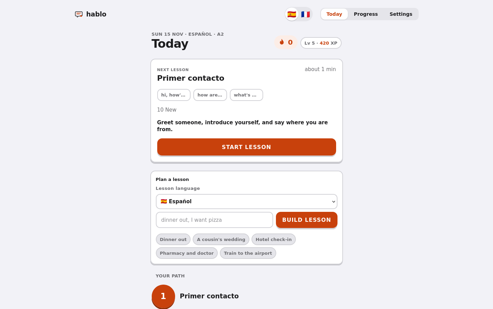

# hablo

**Learn a language by using it, not by memorising a catalogue of translations.**

hablo is a dependency-free, local-first language app with **13 language packs**. Spanish, French, English and Italian are the flagship courses, with full phrase decks; German, Dutch, Portuguese, Russian, Turkish, Arabic, Hindi, Japanese and Chinese are starter courses that use the same learning engine.

There are no accounts, no analytics, no server and no model required. Progress lives in your browser.



## Start it

Use Python 3 (standard library only):

```sh
python3 serve.py
```

The server picks a free port from 8080, prints the URL, opens your browser and disables caching.

```sh
python3 serve.py --port 9000     # pin a port
python3 serve.py --no-open       # do not open a browser
make serve                       # same as python3 serve.py
```

Open the printed `http://localhost:…` address rather than `index.html` directly. Microphone features need a secure context, and `file://` does not provide one.

The app has no build step and no package installation.

## First run

1. Choose the **language you want to learn**.
2. Choose the **interface language**. It stays independent of the learning language.
3. Press **I'm new** to start at the beginning, or **Test me** to take the entry exam.
4. The entry exam adapts while you answer: three correct answers in a row move it up a band, a miss steps it back, and a perfect run can open C1. The current band is shown in the counter.

Your first language is added automatically. To add another later, open **Settings → Your languages → Add language**, choose a language, and complete that language's entry exam. Each language keeps its own level, cards, XP, statistics, custom lessons and conversation history.

Removing a language is deliberate: press the **×** on its card, then confirm. Its local progress for that language is deleted and cannot be undone. The last remaining language cannot be removed.

## The learning loop

The primary action on **Today** is **Start lesson**.

A lesson mixes:

- new cards that teach the word, meaning, sound and usage
- recall of words from earlier lessons
- production, listening, matching, sentence building and message completion
- a short end-of-session review for what you missed

Lessons use spaced repetition. What you miss comes back before the session ends and again when it is due.

### Exercise types

- **Choose the meaning** and **choose the target**
- **Type the translation**
- **Listen and type**
- **Listen and choose**
- **Build a sentence**
- **Complete a message**
- **Match three pairs** — all three must be completed; selected, correct and wrong states are visible
- **Say it** where the browser supports speech recognition

### Vocabulary expansion

**Expand vocabulary** is a separate, deliberately minimal mode:

- one word at a time
- meaning hidden until you ask for it
- **Again** and **Got it** feed the same SRS as lessons
- wrong words return in the session
- every second correct answer adds a harder word
- hearing the word, the example sentence and a progress bar are on the same card
- a missed-word review is one button away at the end
- statistics persist per language; a session also pays XP and coins
- **personal anchors** let you attach a cue such as “my cousin’s wedding”; the cue comes back with the word

### Reading

Each full course has eight reading texts across A1–B2. Starter courses have five. Every text has three multiple-choice questions and an explanation for each wrong option.

### Conversation

**Have a conversation** is usable completely offline. The default **Offline practice** engine uses the app’s own predictor and the active pack’s authored language. It follows authored dialogue turns where they fit, uses recent context, classifies greetings/thanks/yes-no/name/question intents, avoids repeating recent replies and refuses to echo or return runaway text.

A **transfer mission** appears above the conversation. It asks you to use two or three weak/due phrases in the conversation. A phrase counts only when you actually write it; completing the mission gives a small XP award.

A local model is optional. Open **Settings → Conversation engine → Local model**, then press **Find local model**; the app probes `http://localhost:8080` and `http://localhost:11434`, stores the endpoint and model, and switches the conversation engine over. Both llama.cpp's `llama-server` and Ollama work. Without one, no network request is made for conversation.

The same endpoint is used by the word-set **Suggest words** button and the planned-lesson **Suggest with local model** button. The server can be a small GGUF model; see [tools/README.md](tools/README.md) and `tools/local_model.sh`. If it is not running, those assists fall back to the authored pack rather than failing.

### Planned lessons

**Plan a lesson** builds a lesson from a natural-language request such as:

- “dinner out, I want pizza”
- “a cousin’s wedding”
- “hotel check-in”
- “pharmacy and doctor”
- “train to the airport”

Choose the lesson language explicitly. The planner detects the situation, selects the strongest matching phrases, adds due revision, and saves the lesson’s language and focus. Saved lessons can be reopened or deleted from Today.

The planner does not invent a town dialect. If a dialect is not in the pack, it uses the standard language and says so. With a local model connected, **Suggest with local model** extracts extra keywords and situations from your request; if no model answers, the rule-based planner still builds the lesson.

### Words you need

**Learn specific words** is the narrow version of a planned lesson. Paste a list — one word per line, or separated by commas — and the app matches it against the active pack's concepts, phrases, terms and grammar. It shows:

- the words it will teach, with their meaning
- the words the pack does not have yet, honestly labelled
- up to four due reviews, so the session still maintains what is already learned

The set is saved in **My lessons** and can be reopened or deleted. It does not invent vocabulary: a word the pack has not authored is reported, not guessed. This is the feature for a menu, a work meeting, a hospital visit or any list that a generic course does not cover.

You do not have to bring the list yourself. Name an area — “cooking”, “the gym”, “a job interview” — and press **Suggest words**. With a local model connected, hablo asks it for target words and then matches only authored items; without one, it uses the pack’s topic planner and says so.

## Language library

Settings lists every language you are learning with its flag, name and level. Selecting a card switches language. **Add language** starts a new entry exam. **×** removes a language after confirmation.

The interface-language selector is separate and does not change when you switch learning languages.

## Coins and looks

Coins are **earned**, never bought. A finished lesson pays for first-try answers and a clean sheet; expanding vocabulary pays for each correct word; reaching the daily goal pays once. They buy **looks only** — three accent themes in **Settings → Look**:

| look | cost |
|---|---|
| Ember | free |
| Plum | 60 coins |
| Moss | 120 coins |

There is no pay-to-win, no loot, no energy and no learning locked behind the currency. The point is a small, honest pull to come back and finish a card.

## What is local

- Progress, XP, coins, levels, streaks, statistics, vocabulary anchors, custom lessons, word sets and chat history use `localStorage`.
- The chosen accent and the unlocked looks are stored with the same state.
- The storage key is intentionally `sema.v1` for compatibility with older saves.
- Audio ships with the app as pre-rendered WAV files, generated with Piper neural voices; browser speech synthesis is the fallback.
- No account, no analytics, no tracking.
- Offline conversation never contacts a server.
- A configured local model receives only the conversation and prompt needed for chat/translation.

## Audio

Every item ships as a pre-rendered WAV clip, so playback does not depend on a voice installed in the operating system. The clips are generated from the pack data with Piper neural voices, one voice per language, then trimmed, edge-faded, peak-normalised and resampled to the app's 16 kHz mono contract. Spanish keeps its historical flat `assets/audio/` folder; every other pack lives in `assets/audio/<code>/`.

The model files are **not** in the repository. To regenerate a pack on a machine with Piper installed:

```sh
python3 tools/make_audio.py --lang fr --engine piper --voice /path/to/fr_FR-siwis-medium.onnx
python3 tools/make_audio.py --lang fr --check
```

`--check` verifies manifest coverage, that every clip exists, and that it is mono 16-bit PCM at 16 kHz. The app never loads Piper or a model at runtime; it only plays the WAV files, and falls back to the browser's speech synthesis if a clip is missing.

## Verify it

```sh
make check                         # syntax gate + full test suite
node --test tests/                 # tests only
python3 tools/make_audio.py --check # audio manifest/files
```

## Repository layout

```text
index.html                 shell and views
assets/styles.css          visual system
assets/audio/              pre-rendered WAVs and manifests
src/app.js                 application flow, lesson loop, views, SRS integration
src/lang/<code>/           per-language concepts, phrases, texts, dialogues, levels, glosses
src/ui-strings.js          base interface strings
src/ui-langs.js            extra interface locale tables
src/ui-extra.js            newer interface strings
src/srs.js                 scheduling and answer matching
src/memory.js              personal sentences and cloze cards
src/wordset.js             word-list matching for a focused lesson
src/economy.js             earned coins and the cosmetic look costs
src/chat-engine.js         optional local-model adapter
src/mini-chat.js           dependency-free offline conversation predictor
src/exercises.js           extra exercise helpers
src/track.js               curriculum track
src/curriculum.js          topic and unit resolution
tools/make_audio.py        audio generator and checker
tests/                     node:test suites
serve.py                   local static server
docs/                      preview image and project notes
```

## License

MIT — see [LICENSE](LICENSE).

More design notes and honest limits are in [DEMO.md](DEMO.md). The gamification proposal, with its approval checklist, is in [docs/GAMIFICATION.md](docs/GAMIFICATION.md).
