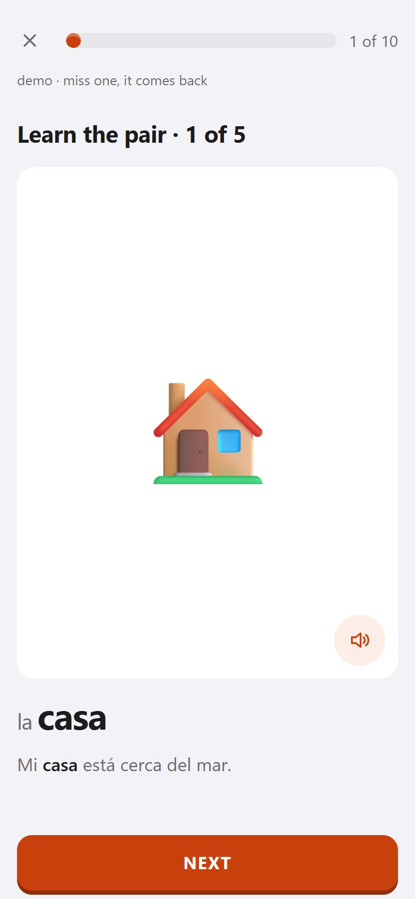
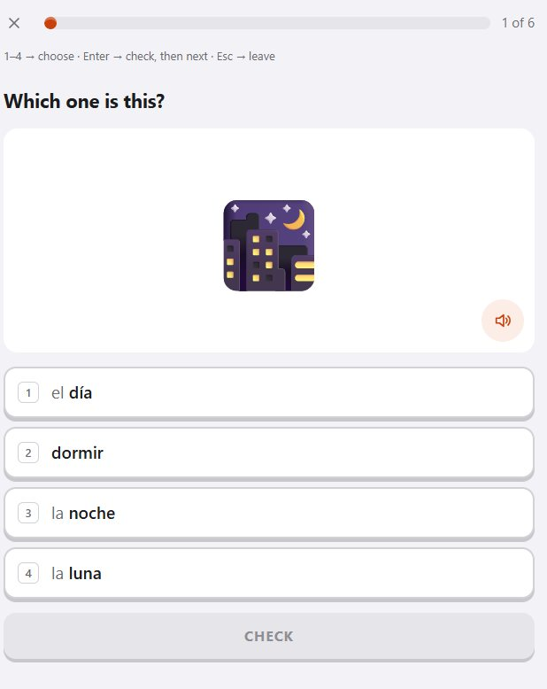
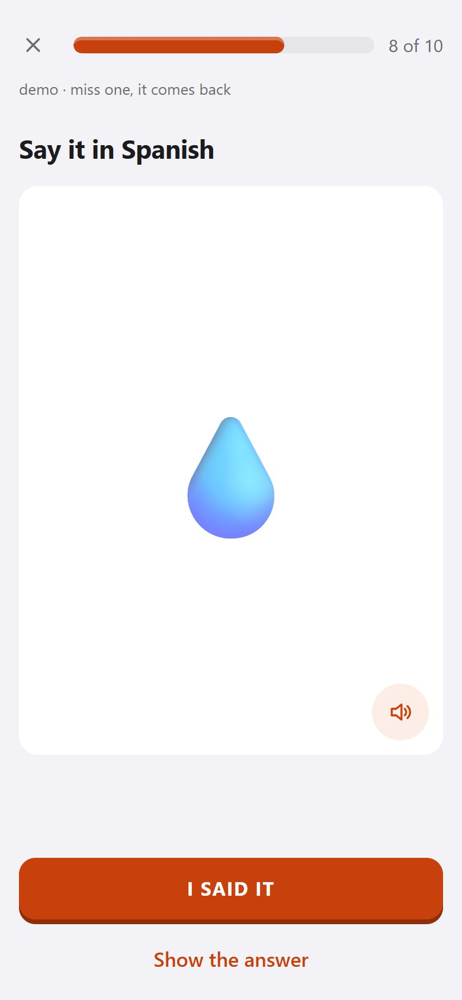
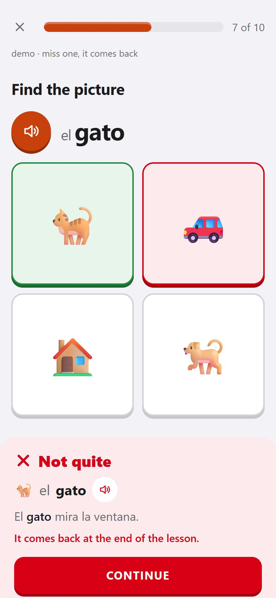
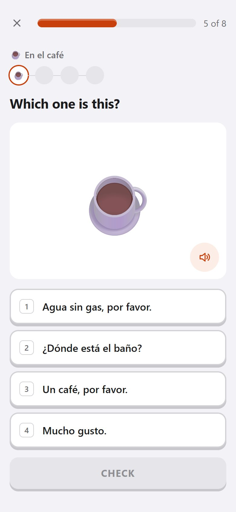
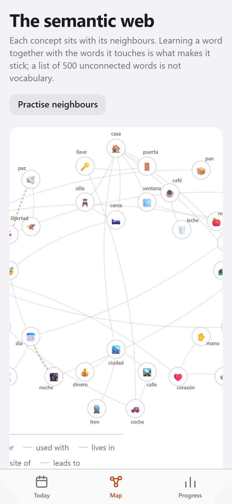
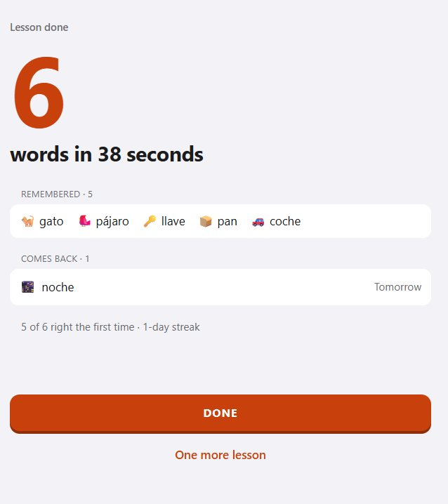

# sema — здесь можно увидеть

sema учит испанский без перевода: картинка, слово и звук, потом короткий квиз
и повторение по расписанию.

## Попробовать самому

1. Откройте файл [`sema-demo.html`](sema-demo.html) и нажмите кнопку **Download raw file** (стрелка вниз справа).
2. Откройте скачанный файл в браузере (Chrome, Edge, Safari).
3. Сразу начнётся урок на минуту: 5 слов, три типа вопросов, а ошибка вернётся в конце.

Интернет не нужен, звук вшит в файл. Прогресс не сохраняется: каждый раз урок с чистого листа.
На iPhone файл нужно открыть в Safari, во встроенном просмотрщике кнопки не работают.

## Как это выглядит

### Главный экран

### Урок на телефоне

| Знакомство со словом | Вопрос | Сказать вслух |
|---|---|---|
|  |  |  |

### Выбрал — проверил — панель снизу

| Выбор картинки | Ответ |
|---|---|
|  |  |

### Фразы идут сценками

| Сценка «En el café» | Карта: слова по темам |
|---|---|
|  |  |

### Итог урока

