# sema — здесь можно увидеть

sema учит испанский без перевода: картинка, слово и звук, потом короткий квиз
и повторение по расписанию. Есть путь уроков, разговор с собеседником и второй язык — французский.

## Попробовать самому

1. Откройте файл [`sema-demo.html`](sema-demo.html) и нажмите кнопку **Download raw file** (стрелка вниз справа).
2. Откройте скачанный файл в браузере (Chrome, Edge, Safari).
3. Сразу начнётся урок на минуту: 5 слов, три типа вопросов, а ошибка вернётся в конце.

Интернет не нужен, звук вшит в файл. Демо каждый раз начинается с чистого листа.
Чтобы открыть всё приложение, а не демо, сотрите в адресной строке `#demo` в конце и обновите страницу.
На iPhone файл нужно открыть в Safari, во встроенном просмотрщике кнопки не работают.

## Как это выглядит

### Первый запуск и главный экран

| Первый запуск | Главный экран: урок и путь | Тёмная тема |
|---|---|---|
| 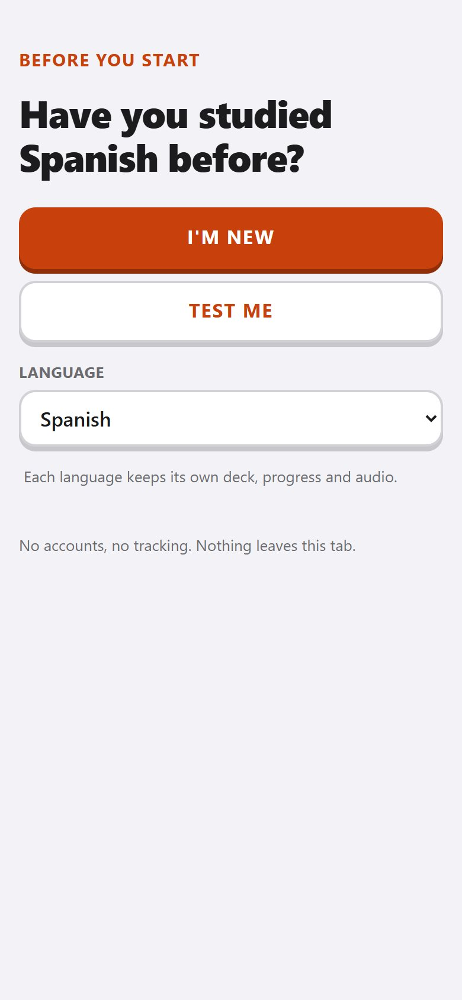 | 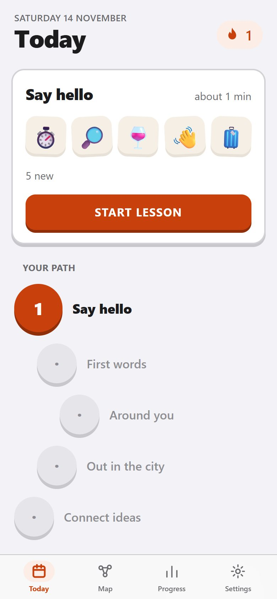 | 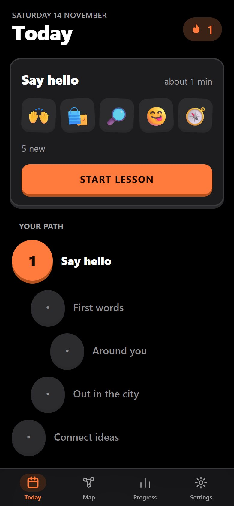 |

### Урок: выбрал — проверил — панель снизу

| Новое слово | Ответ | Найди картинку | Ошибка |
|---|---|---|---|
| 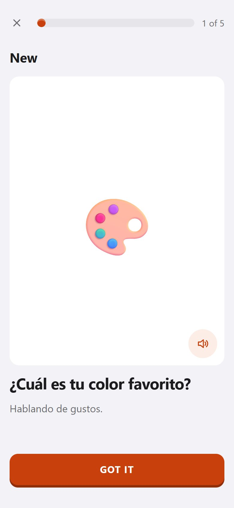 |  | 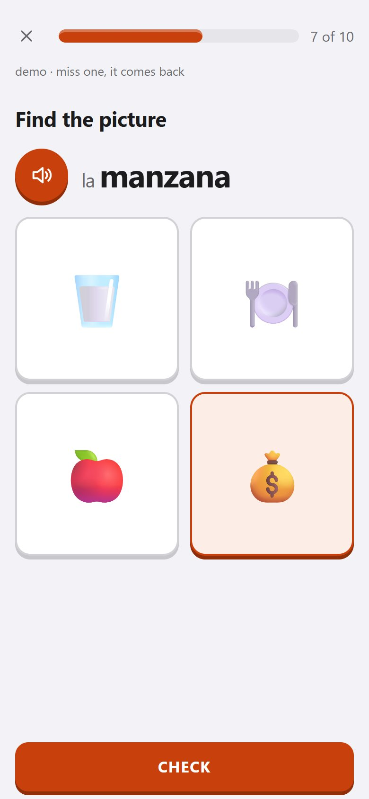 | 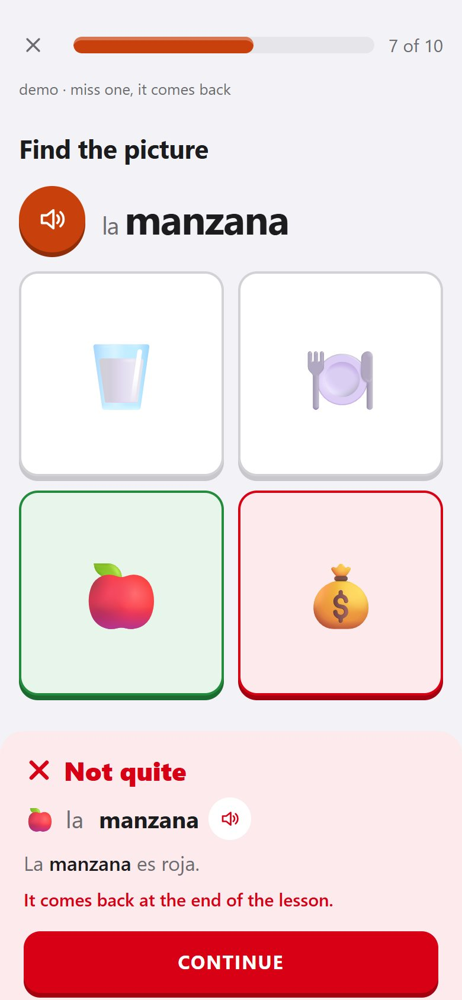 |

### Разговор и итог урока

| Разговор | Итог урока |
|---|---|
| 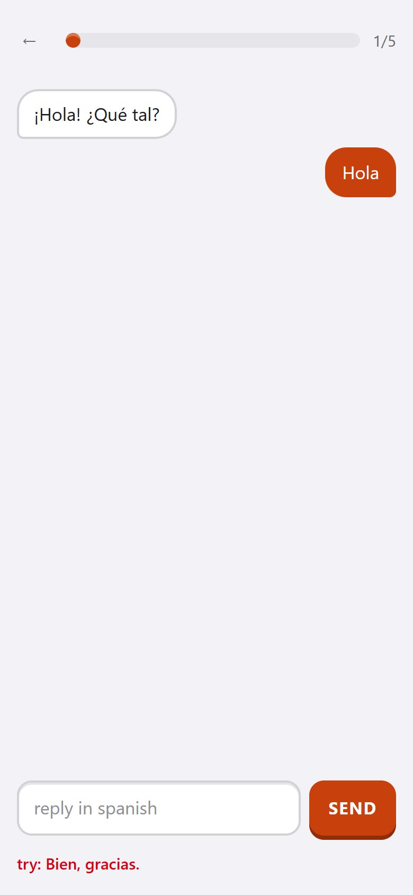 |  |

### Карта, прогресс, настройки

| Карта слов | Прогресс | Настройки |
|---|---|---|
| 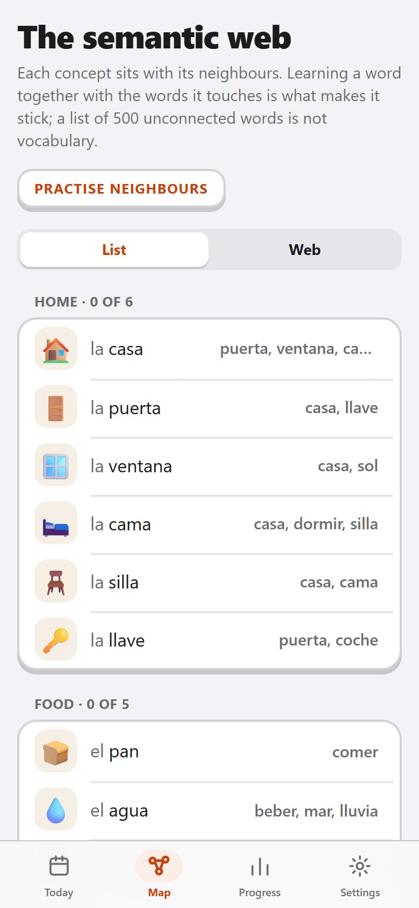 | 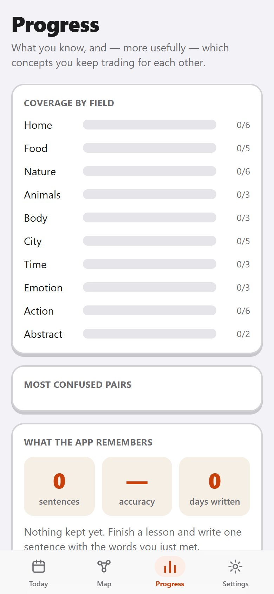 | 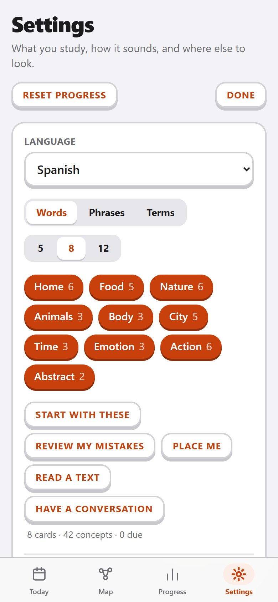 |

### На компьютере

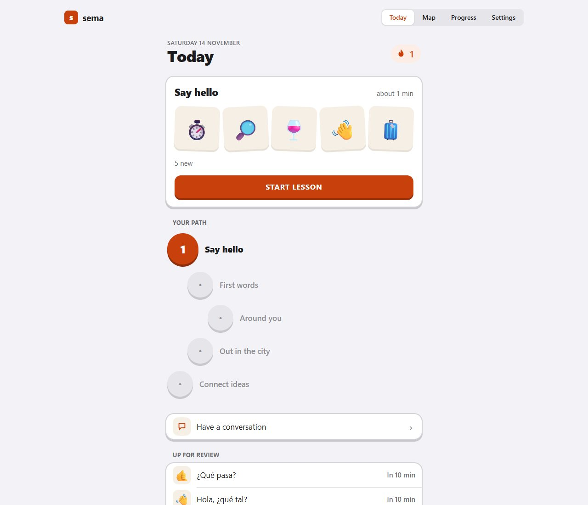
